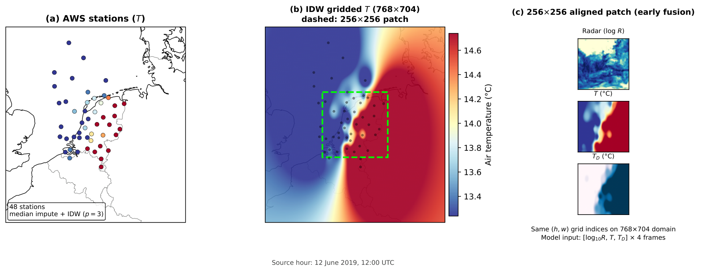

# Precipitation nowcasting with EarthFormer

This is a code release for the MSc thesis: Thermodynamic Context in Earthformer for Precipitation Nowcasting. The repository contains the training/evaluation stack,
AWS→IDW auxiliary-grid builders, classical baselines, and the exact 2019 test
indices used in the reported numbers.



*Thermodynamic auxiliary construction (thesis Fig.): (a) KNMI AWS temperatures, (b) IDW-gridded \(T\) on the \(768\times704\) radar domain with a \(256\times256\) patch, (c) early-fusion input \([\log_{10}R,\,T,\,T_D]\).*

This is mostly a reduced fork of Mats Robben’s [`nowcasting`](https://github.com/MatsRobben/nowcasting) package (EarthFormer + KNMI Zarr dataloader) and unused models (DGMR, LDCast, FiLM/VSN variants, satelite pipelines) are omitted.

## What is in this repo

|Path|Role|
|-|-|
|`nowcasting/`|EarthFormer, dataloader, metrics, eval|
|`config/earthformer/thesis\\\_scaling\\\_v1/`|Train configs (radar / radar+aux × 5–100% data)|
|`config/earthformer/thesis\\\_scaling\\\_v1\\\_eval2019/`|2019 test eval configs + S-PROG / persistence|
|`config/earthformer/thesis\\\_scaling\\\_v1\\\_extend20e\\\_eval2019/`|50% and 100% extra-epoch eval configs|
|`scripts/`|Train, index generation, baseline dump/score|
|`scripts/auxiliary/`|Download KNMI AWS, IDW grids, and T/Td data|
|`indices/`|Fixed train/val/test patch indices|

Radar Zarr archives and model checkpoints are **not** included (They can be downloaded from KNMI).

## Data (not in GitHub)

You need:

1. KNMI RTCOR radar on a 768×704, 5-minute grid for 2008–2019.
2. For Track B (radar+aux): AWS hourly temperature and dewpoint, IDW-interpolated onto that grid.

Environment variables used by the YAML configs:

```bash
export THESIS\\\_DATA\\\_ROOT=/path/to/zarr/parent
export THESIS\\\_INDEX\\\_DIR=$PWD/indices
```

Expected files:

* `$THESIS\\\_DATA\\\_ROOT/radar\\\_2008\\\_2019\\\_radar\\\_only\\\_v1.zarr` — Track A
* `$THESIS\\\_DATA\\\_ROOT/radar\\\_2008\\\_2019\\\_combined\\\_with\\\_aux\\\_v3.zarr` — Track B

Auxiliary fields live in a Zarr group named `harmonie` with names `TMP\\\_GDS0\\\_HTGL` and `DPT\\\_GDS0\\\_HTGL` for pipeline compatibility. They are **AWS IDW grids, not HARMONIE NWP**(old naming can be found to fit older pipelines).

## Setup

```bash
python -m venv .venv
source .venv/bin/activate
pip install -e .
```

Python 3.11+ is recommended.

## Rebuld the dataset

Yearly radar Zarrs → one archive:

```bash
python scripts/combine\\\_old\\\_years\\\_zarr.py combine \\\\
  --sources /path/to/radar\\\_2008.zarr ... /path/to/radar\\\_2019.zarr \\\\
  --output $THESIS\\\_DATA\\\_ROOT/radar\\\_2008\\\_2019\\\_radar\\\_only\\\_v1.zarr
```

AWS download + IDW grids (`KNMI\\\_API\\\_KEY` must be set):

```bash
export KNMI\\\_API\\\_KEY=your\\\_key
python scripts/auxiliary/download\\\_hourly\\\_validated\\\_full\\\_2008\\\_2019.py \\\\
  --out-root /path/to/hourly\\\_aws \\\\
  --log-json ./data\\\_cache/aws\\\_download.json
python scripts/auxiliary/build\\\_oldyears\\\_aux\\\_zarr.py \\\\
  --source-zarr $THESIS\\\_DATA\\\_ROOT/radar\\\_2008\\\_2019\\\_radar\\\_only\\\_v1.zarr \\\\
  --output-zarr $THESIS\\\_DATA\\\_ROOT/radar\\\_2008\\\_2019\\\_combined\\\_with\\\_aux\\\_v3.zarr \\\\
  --hourly-dir /path/to/hourly\\\_aws \\\\
  --report-dir ./data\\\_cache/aux\\\_reports
python scripts/auxiliary/compute\\\_joint\\\_temp\\\_dew\\\_norm.py \\\\
  --zarr-path $THESIS\\\_DATA\\\_ROOT/radar\\\_2008\\\_2019\\\_combined\\\_with\\\_aux\\\_v3.zarr \\\\
  --out-json ./data\\\_cache/joint\\\_temp\\\_dew\\\_norm.json
```

Rain-event indices (already provided under `indices/`):

```bash
python scripts/generate\\\_thesis\\\_scaling\\\_indices.py \\\\
  --config config/earthformer/thesis\\\_scaling\\\_v1/radar\\\_aux\\\_\\\_100pct.yaml \\\\
  --out\\\_dir indices
```

Splits: train 2008–2017, val 2018, test 2019.

## Train

```bash
python scripts/train.py --config config/earthformer/thesis\\\_scaling\\\_v1/radar\\\_\\\_010pct.yaml
python scripts/train.py --config config/earthformer/thesis\\\_scaling\\\_v1/radar\\\_aux\\\_\\\_010pct.yaml
```

50% and 100% models in the thesis used an extended schedule (`extend20e`). Point `model.checkpoint\\\_path` at a checkpoint to resume.

## Evaluate (2019 rainy test set)

```bash
python nowcasting/scripts/eval.py \\\\
  --config config/earthformer/thesis\\\_scaling\\\_v1\\\_eval2019/radar\\\_\\\_100pct.yaml \\\\
  --model.checkpoint\\\_path /path/to/best.ckpt
```

`scripts/pick\\\_best\\\_ckpt\\\_from\\\_tb.py` selects the checkpoint nearest the best TensorBoard `val/loss`.

Metrics: CSI, RMSE, MAE, FSS on the same lead-time / threshold grid as the thesis.

## 

## Classical baselines

S-PROG (PySTEPS) and persistence use the same 2019 test dump. 

```bash
python scripts/dump\\\_thesis\\\_test2019\\\_radar.py \\\\
  --config config/earthformer/thesis\\\_scaling\\\_v1\\\_eval2019/sprog\\\_baseline.yaml \\\\
  --out results/evaluations/\\\_thesis\\\_baseline\\\_dump.h5

python scripts/run\\\_thesis\\\_classical\\\_nowcast.py \\\\
  --dump results/evaluations/\\\_thesis\\\_baseline\\\_dump.h5 \\\\
  --out results/evaluations/sprog\\\_shard0.h5 \\\\
  --method sprog

python scripts/score\\\_thesis\\\_classical\\\_baselines.py \\\\
  --dump results/evaluations/\\\_thesis\\\_baseline\\\_dump.h5 \\\\
  --preds results/evaluations/sprog\\\_shard0.h5 \\\\
  --model-name thesis\\\_baseline\\\_\\\_sprog\\\_\\\_test2019
```

## Citation

If you use this code, please cite the thesis and the upstream EarthFormer / nowcasting work:

* Gao et al., *Earthformer*, ICLR 2022
* Robben, `nowcasting` (KNMI / Radboud)
* Van Nooten et al. for parts of `nowcasting/utils.py`

